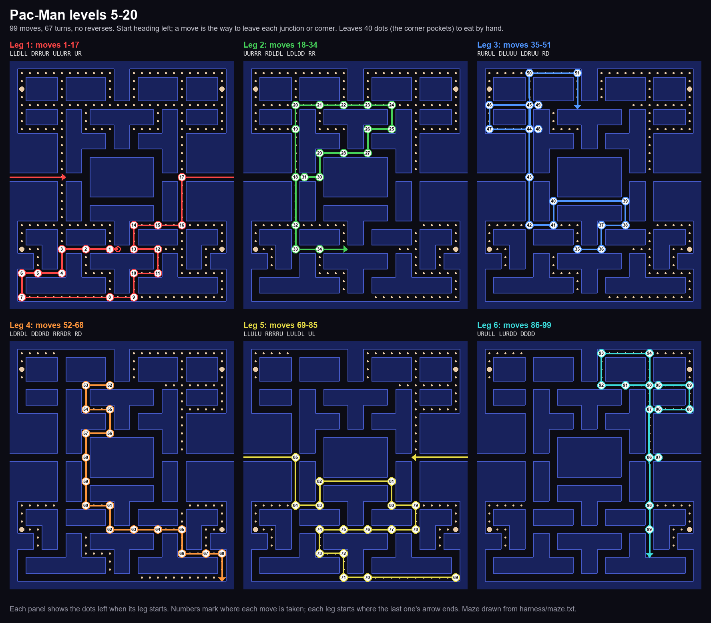
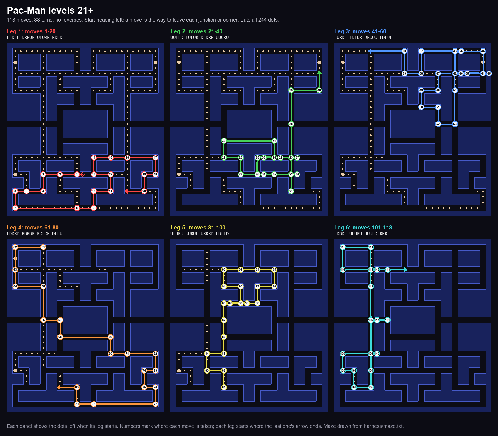

# Pac-Man Pattern Finder

Finds memorable, timing-tolerant Pac-Man patterns by letting MAME play the game headless under
Lua control: a beam search over routes (junction to junction, no reversing), then every route is
replayed with each turn pressed 1–4 frames late to find the ones that forgive sloppy timing.

Published arcade patterns often fail on MAME, so these were found and checked on MAME 0.289.

## The patterns

Routes are the direction to leave each junction or corner (R D L U), starting from Pac-Man's start
heading left. Details, timing data and older patterns are in [`best/`](best/README.md).

| Levels | File | Moves / turns | Notes |
|---|---|---|---|
| 1 | — | — | played by hand |
| 5–20 | `best/L5-20_nopockets_99.json` | 99 / 67 | leaves the 4 corner pockets to eat by hand |
| 21+ | `best/L21_full_118.json` | 118 / 88 | full clear, both fruits, ~48 s; starts like 5–20 |

Pattern sheets, one image each (drawn from our own maze file, made by `harness/pattern_sheet.py`):

Videos (played by MAME exactly on time): 5–20 on [level 5](videos/L5-20_99_level5.mp4) (the corner
dots are left to eat by hand) and 21+ on [level 21](videos/L21_118_level21.mp4).

For comparison, Don Goodrich's well-known level 21+ "9th key" pattern
([StrategyWiki](https://strategywiki.org/wiki/Pac-Man/Walkthrough)) is 117 moves / 84 turns with one
reverse and takes ~53 s. It clears on MAME when played exactly on time, but 131 single late presses
kill it versus 31 for the 118/88 (`harness/goodrich_late.py`).

## Running it

You need MAME 0.289 in `mame-0.289/` and your own legally obtained `pacman.zip` ROM in
`mame-0.289/roms/`. **No ROM or MAME binaries are included.** The search lives in `harness/`
(`search.py`, `rank_sols.py`, `server.lua`); `HANDOFF.md` has the full notes. `mame-patches/` has
optional MAME patches (in-memory save states, faster headless running).

## License

MIT, except `mame-patches/`, which is GPL-2.0-or-later like MAME. See [LICENSE](LICENSE).

Pac-Man is a trademark of Bandai Namco Entertainment Inc. This project is not affiliated with or
endorsed by Bandai Namco or the MAME project.
