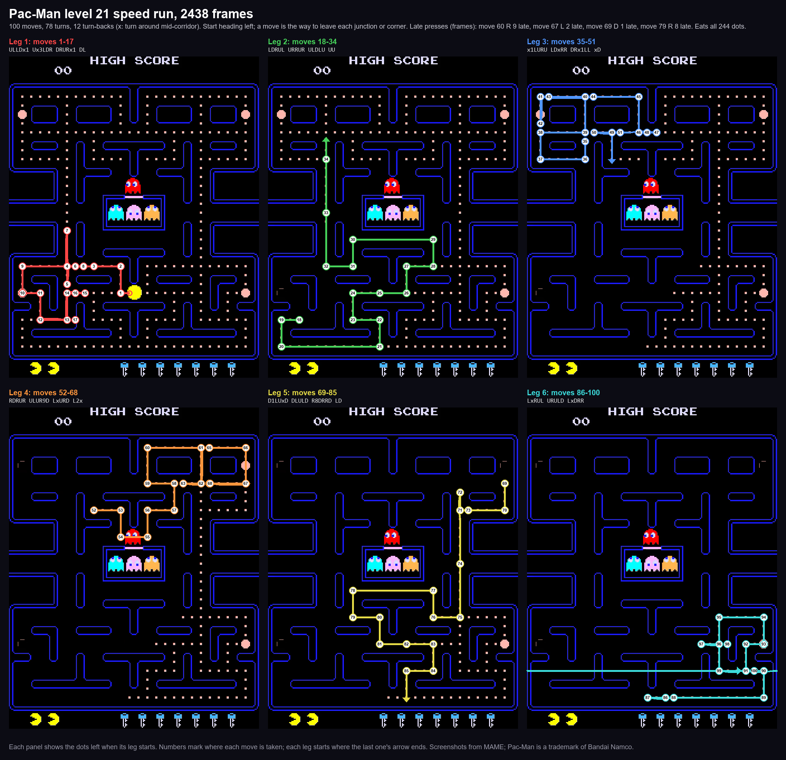

# Pac-Man Pattern Finder

Finds memorable, timing-tolerant Pac-Man patterns by letting MAME play the game headless under
Lua control: a beam search over routes (junction to junction, no reversing), then every route is
replayed with each turn pressed 1–4 frames late to find the ones that forgive sloppy timing.

The point is not "perfect" frame-exact routes for a real arcade cabinet. It is routes that survive
crappy or emulated machines: input lag, a mushy stick or keyboard, presses that land a few frames
late. Routes are ranked by how much of that they forgive. Published arcade patterns often fail on MAME, so
these were found and checked on MAME 0.289.

## The patterns

Routes are the direction to leave each junction or corner (R D L U), starting from Pac-Man's start
heading left. Details, timing data and older patterns are in [`best/`](best/README.md).

| Levels | File | Moves / turns | Notes |
|---|---|---|---|
| 1 | `best/L1_allghosts_129.json` | 129 / 95 | all 16 ghosts, both fruits, full clear |
| 2 | `best/L2_allghosts_139.json` | 139 / 102 | all 16 ghosts, both fruits, full clear |
| 3 | `best/L3_allghosts_147.json` | 147 / 107 | all 16 ghosts, both fruits, full clear |
| 4 | `best/L4_allghosts_171.json` | 171 / 130 | all 16 ghosts, both fruits, full clear |
| 5–20 | `best/L5-20_keep70_115.json` | 115 / 78 | **leave the corners**: eats both fruits, leaves the corner pockets to eat by hand; any one turn can be pressed 1–4 frames late |
| 21+ | `best/L21_full_118.json` | 118 / 88 | **2-fruit full clear**, ~50 s; starts like 5–20 |
| 21+ (safe) | `best/L21_safe141.json` | 141 / 104 | the 118 to move 110, then an ending that dodges blue wherever it is, ~61 s |

The level 1–4 ghost routes need exact timing: a late press can cost a ghost or a life (see [`best/`](best/README.md)).
The 5–20 and 21+ routes are the timing-tolerant ones.

Every video is played by MAME exactly on time, with a line under the maze giving the move number, the press
and the frame count.

### Levels 1–4: all the ghosts

Videos: [level 1](videos/L1_16ghosts_129_level1.mp4),
[level 2](videos/L2_16ghosts_139_level2.mp4), [level 3](videos/L3_16ghosts_147_level3.mp4),
[level 4](videos/L4_16ghosts_171_level4.mp4).

### Levels 5–20: leave the corners

Videos: [level 5](videos/L5-20_keep70_115_level5.mp4) and [level 20](videos/L5-20_keep70_115_level20.mp4)
(the corner dots are left to eat by hand).

### Levels 21+: two fruits, full clear

Video: [level 21](videos/L21_118_level21.mp4).

**Safe ending** (`best/L21_safe141.json`, video: [level 21](videos/L21_safe141_level21.mp4)): the 118's ending
(moves 111–118) works when you are on time, but if earlier presses drift a little, blue can be waiting in the
top left. The safe ending plays the 118 up to move 110, then goes along the top row to the top-right corner,
back along row 5, takes a lap down the left-middle corridor, along the bottom and out the right tunnel, and eats
the top-left dots last. It was searched against 24 simulated sloppy games (turns from move 80 on pressed 1–2
frames late at random) and then survived all 90 fresh ones it was checked on (`harness/drift_end.py`), against
33 of 46 for the 118's own ending. It costs about 11 s.

Plain drawn versions of every sheet, without game graphics, are in `best/` (made by `harness/pattern_sheet.py`).

For comparison, Don Goodrich's well-known level 21+ "9th key" pattern
([StrategyWiki](https://strategywiki.org/wiki/Pac-Man/Walkthrough)) is 117 moves / 84 turns with one
reverse and takes ~53 s. It clears on MAME when played exactly on time, but 131 single late presses
kill it versus 31 for the 118/88 (`harness/goodrich_late.py`).

### Level 21+ speed run (just for fun)

Video: [level 21 in 2438 frames](videos/L21_speed_2438_level21_annotated.mp4) (40.23 s from start to clear,
both fruits eaten; [without the annotation](videos/L21_speed_2438_level21.mp4)). The previous best,
[2458 frames](videos/L21_speed_2458_level21.mp4) (40.56 s), is `harness/result_L21_guide_gc10_sl25_cc40.json`. Route: `best/L21_speed_2438.json`, 100 moves with 12 turn-backs and 4 deliberately late presses.
It is frame-exact (the late presses make ghosts miss by a few pixels; it never passes through one), so it is
not meant for human play. The late presses, counting moves from 1 and frames from when Pac-Man is within
4 pixels of the turn (at a corner he stops at the wall and waits): move 60 R, 9 frames late; move 67 L, 2 late;
move 69 D, 1 late; move 79 R, 8 late. Every other move is pressed as early as possible, and the turn-backs
happen on exact tiles. The fastest
possible clear with no ghosts at all is about 2337 frames. Found by `harness/climb.py`: change one move of the
best route, search again from there, and keep the result if it is faster. The log is in `harness/RUNS.md`.

## Running it

You need MAME 0.289 in `mame-0.289/` and your own legally obtained `pacman.zip` ROM in
`mame-0.289/roms/`. **No ROM or MAME binaries are included.** The search lives in `harness/`
(`search.py`, `rank_sols.py`, `server.lua`); `HANDOFF.md` has the full notes. `mame-patches/` has
optional MAME patches (in-memory save states, faster headless running).

## License

MIT, except `mame-patches/`, which is GPL-2.0-or-later like MAME. See [LICENSE](LICENSE).

Pac-Man is a trademark of Bandai Namco Entertainment Inc. This project is not affiliated with or
endorsed by Bandai Namco or the MAME project.
