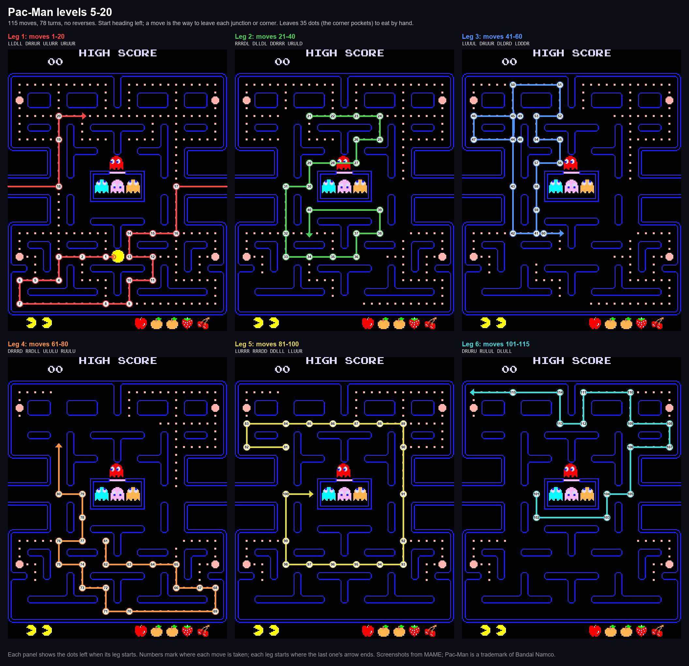
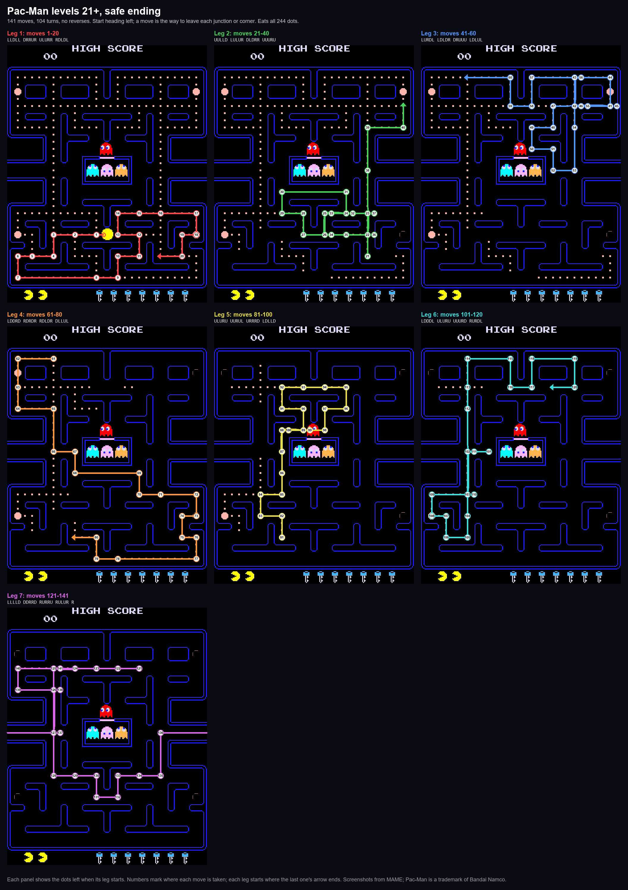

# Tolerant patterns

Patterns meant to be played by hand on real or emulated machines that are not perfect: input lag, a mushy stick
or keyboard, presses that land a few frames late. They were found and checked on MAME 0.289.

Routes are the direction to leave each junction or corner (R D L U), starting from Pac-Man's start position
heading left. None of them reverses. Every video is MAME playing the route exactly on time, with a line under
the maze giving the move number, the press and the frame count. The `_screen.png` sheets are drawn on the game
graphics; the plain `.png` sheets are the same patterns drawn without them (`harness/pattern_sheet.py`).

| Levels | Folder | File | Moves / turns | Time | What it does |
|---|---|---|---|---|---|
| 5–20 | [`L5-20/`](L5-20/) | `L5-20_keep70_115.json` | 115 / 78 | 2971 frames (~50 s) | eats both fruits; leaves the corner pockets to eat by hand |
| 21+ | [`L21+/`](L21+/) | `L21_safe141.json` | 141 / 104 | 3727 frames (~61 s) | full clear, both keys; an ending that dodges blue wherever it is |

## Levels 5–20: leave the corners

Videos: [level 5](L5-20/L5-20_keep70_115_level5.mp4), [level 20](L5-20/L5-20_keep70_115_level20.mp4)
(the corner dots are left to eat by hand).

No single late press kills it on any level from 5 to 20; the search required that. Each turn was replayed
pressed 1–4 frames past the point where Pac-Man would corner cleanly, alone and in pairs (`harness/rank_sols.py`).
532 pairs of late presses kill, spread over moves 40–112, worst on levels 15–18. The JSON lists them.

## Levels 21+: two keys, full clear

Video: [level 21](L21+/L21_safe141_level21.mp4).

Levels 21–255 play the same, so this covers all of them. It is the 118-move route (`L21_full_118.json`, its first
15 moves are the 5–20 route) up to move 110, then a 31-move ending: after move 113 (up the middle-left corridor
to the top row) go right along the top, up into the top-right corner, back left along row 5, down the long
corridor, along the bottom, out the right tunnel, up the left side, and eat the top-left dots last.

Why: the 118's own ending (moves 111–118) is fine on time, but if earlier presses drift, blue's loop can meet you
in the top left. `harness/drift_end.py` plays the 118 with every turn from move 80 to move 110 pressed 1–2 frames
late with chance 0.3, then tries each ending. With the ending also pressed sloppily, the 141 survived 46/46 games,
the 118's ending 33/46. It costs about 11 s. Drift spread over the first half of the route can still kill at moves
37, 45–46 or 78; this only fixes the end.

The 118 on its own, played on time: [video](L21+/L21_118_level21.mp4), [sheet](L21+/L21_118_screen.png),
~50 s. For comparison, Don Goodrich's well-known level 21+ "9th key" pattern
([StrategyWiki](https://strategywiki.org/wiki/Pac-Man/Walkthrough)) is 117 moves / 84 turns with one reverse and
takes ~53 s; 131 single late presses kill it versus 31 for the 118 (`harness/goodrich_late.py`).
